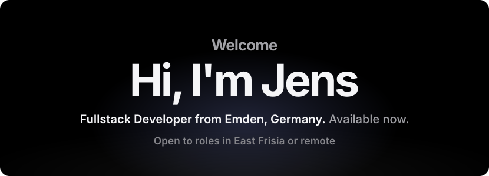
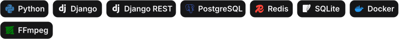
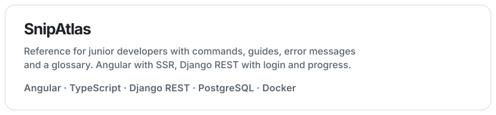
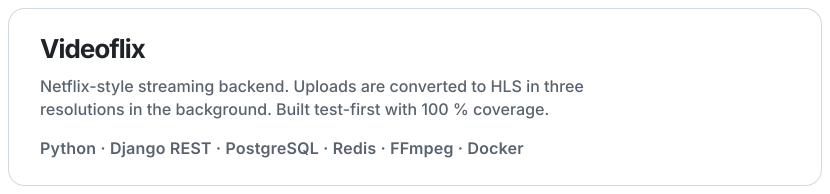
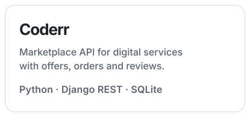
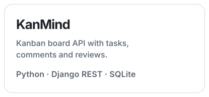
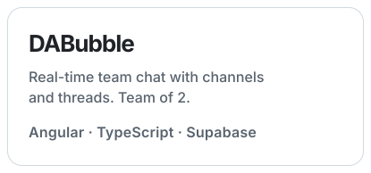
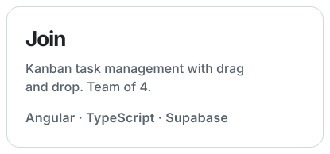

  

  
  
  
  

---

## About Me

I spent years in retail and sales before I noticed that I enjoy building things a lot more than selling them. So I made the switch. Right now I'm finishing a one-year Fullstack Developer training at the Developer Akademie, and most evenings you'll find me working on my own projects.

I like to dig into a topic until I really understand why something works, not just that it works. I'm also a bit obsessed with structure. If something isn't sorted properly, I can't leave it alone, and in code that turns out to be pretty useful: clear names, a tidy folder structure and functions that do exactly one thing.

What I work with:

- **Backend:** REST APIs with Python, Django and Django REST Framework, including authentication, background jobs and Docker
- **Frontend:** responsive apps with Angular, TypeScript and SCSS
- **How I work:** test-driven, clean code, documentation that actually helps the next person
- **AI:** I use AI tools for research and debugging, and I check every suggestion against the docs and tests before I use it

When I'm not coding, I make music, play strategy games, spend time with my family and go for walks with our dog Balu.

---

## Tech Stack

**Backend**

**Frontend**

**Tools**

---

## Projects I'm Proud Of

<a href="https://snipatlas.jensbaumann.com/"><picture><source media="(prefers-color-scheme: dark)" srcset="assets/card-snipatlas-dark.svg"></picture></a> <a href="https://github.com/JensBaumannDev/SnipAtlas"><picture><source media="(prefers-color-scheme: dark)" srcset="assets/link-code-dark.svg"></picture></a>

<a href="https://videoflix.jensbaumann.com/"><picture><source media="(prefers-color-scheme: dark)" srcset="assets/card-videoflix-dark.svg"></picture></a> <a href="https://github.com/JensBaumannDev/Videoflix"><picture><source media="(prefers-color-scheme: dark)" srcset="assets/link-code-dark.svg"></picture></a>

<a href="https://coderr.jensbaumann.com/"><picture><source media="(prefers-color-scheme: dark)" srcset="assets/card-coderr-dark.svg"></picture></a><a href="https://kanmind.jensbaumann.com/"><picture><source media="(prefers-color-scheme: dark)" srcset="assets/card-kanmind-dark.svg"></picture></a> <a href="https://github.com/JensBaumannDev/Coderr_Backend"><picture><source media="(prefers-color-scheme: dark)" srcset="assets/link-code-dark.svg"></picture></a><a href="https://github.com/JensBaumannDev/KanMind_Backend"><picture><source media="(prefers-color-scheme: dark)" srcset="assets/link-code-dark.svg"></picture></a>

<a href="https://dabubble.jensbaumann.com/"><picture><source media="(prefers-color-scheme: dark)" srcset="assets/card-dabubble-dark.svg"></picture></a><a href="https://join.jensbaumann.com/"><picture><source media="(prefers-color-scheme: dark)" srcset="assets/card-join-dark.svg"></picture></a> <a href="https://github.com/JensBaumannDev/DABubble"><picture><source media="(prefers-color-scheme: dark)" srcset="assets/link-code-dark.svg"></picture></a><a href="https://github.com/JensBaumannDev/Join"><picture><source media="(prefers-color-scheme: dark)" srcset="assets/link-code-dark.svg"></picture></a>

## More Projects

- **Quizly**: Django REST API with JWT authentication for a quiz app ([Code](https://github.com/JensBaumannDev/Quizly))
- **El Pollo Loco**: a jump-and-run game with its own game loop, sound and collision detection ([Live](https://el-pollo-loco.jensbaumann.com/) | [Code](https://github.com/JensBaumannDev/El-Pollo-Loco))
- **Pokédex**: a multilingual Pokédex with live data from the PokéAPI ([Live](https://pokedex.jensbaumann.com/) | [Code](https://github.com/JensBaumannDev/Pokedex))

---

**Got a job, a project or just an idea? I'd love to hear from you.**

[jensbaumann.com](https://jensbaumann.com/) | [LinkedIn](https://www.linkedin.com/in/jens-baumann-7a6866315/) | [Malt](https://www.malt.de/profile/jensbaumann) | [info@jensbaumann.com](mailto:info@jensbaumann.com)

